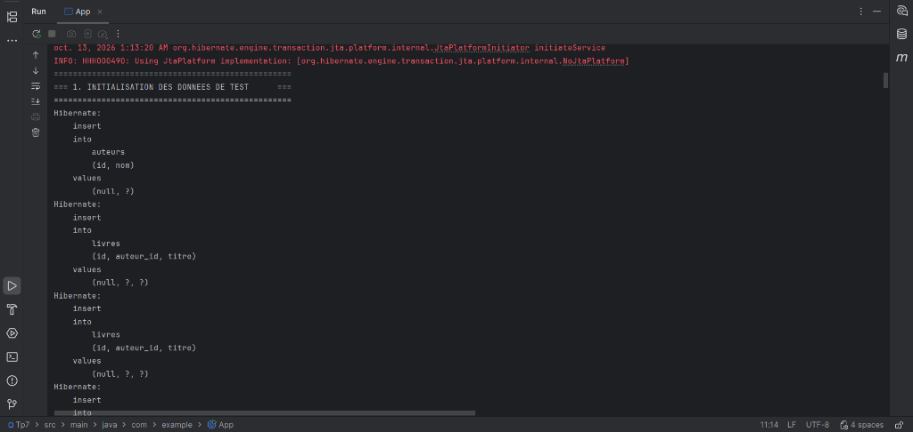

# TP 7 : Activation du cache de second niveau, optimisation des performances et suppression du problème N+1 avec JOIN FETCH et Entity Graph

Ce projet illustre l'optimisation des performances d'accès aux données avec **JPA (Java Persistence API)** et **Hibernate ORM**, en traitant spécifiquement le **problème N+1 requêtes** et la mise en œuvre d'un **cache de second niveau (L2 Cache)** avec **Ehcache 3**.

---

## 📸 Capture d'exécution



---

## 🎯 Objectifs du TP

1. **Modélisation JPA** : Définir une relation bidirectionnelle `@OneToMany` / `@ManyToOne` entre `Auteur` et `Livre` avec chargement paresseux (`FetchType.LAZY`).
2. **Mise en évidence du problème N+1** : Observer la multiplication des requêtes SQL lors de l'accès aux collections paresseuses.
3. **Résolution par `JOIN FETCH`** : Réduire le nombre de requêtes à 1 seule via la clause JPQL `JOIN FETCH`.
4. **Résolution par `Entity Graph`** : Déclarer un `@NamedEntityGraph` pour charger les associations sans altérer la syntaxe JPQL de base.
5. **Activation du Cache de Second Niveau (L2 Cache)** : Configurer **Ehcache 3** via JCache (JSR-107) pour conserver les entités en mémoire et éliminer les accès redondants à la base de données à travers différentes sessions.

---

## 🏗️ Structure du Projet

```text
Tp7/
├── pom.xml                                      # Dépendances Maven (Hibernate, Ehcache, JCache, H2)
├── screenshots/
│   └── execution.png                            # Capture d'écran de l'exécution
├── src/
│   └── main/
│       ├── java/
│       │   └── com/
│       │       └── example/
│       │           ├── App.java                 # Classe principale orchestrant tous les tests
│       │           ├── model/
│       │           │   ├── Auteur.java          # Entité Auteur (@Cacheable, @NamedEntityGraph)
│       │           │   └── Livre.java           # Entité Livre (@Cacheable)
│       │           └── service/
│       │               ├── DataInitService.java # Service d'initialisation du jeu de données
│       │               └── PerformanceTestService.java # Mesures comparatives des performances
│       └── resources/
│           ├── META-INF/
│           │   └── persistence.xml              # Configuration JPA, Hibernate & JCache
│           └── ehcache.xml                      # Configuration des régions de cache Ehcache 3
└── README.md
```

---

## ⚙️ Configuration Technique

### 1. Cache Ehcache 3 (`src/main/resources/ehcache.xml`)

La configuration définit la taille du tas (heap) et la durée de vie (TTL) pour chaque région :

```xml
<config xmlns:xsi='http://www.w3.org/2001/XMLSchema-instance'
        xmlns='http://www.ehcache.org/v3'
        xsi:schemaLocation='http://www.ehcache.org/v3 http://www.ehcache.org/schema/ehcache-core-3.0.xsd'>

    <cache alias="com.example.model.Auteur">
        <expiry><ttl unit="minutes">60</ttl></expiry>
        <heap unit="entries">1000</heap>
    </cache>

    <cache alias="com.example.model.Livre">
        <expiry><ttl unit="minutes">60</ttl></expiry>
        <heap unit="entries">1000</heap>
    </cache>

    <cache alias="com.example.model.Auteur.livres">
        <expiry><ttl unit="minutes">60</ttl></expiry>
        <heap unit="entries">1000</heap>
    </cache>

    <cache alias="org.hibernate.cache.spi.UpdateTimestampsCache">
        <heap unit="entries">10000</heap>
    </cache>
    <cache alias="default-update-timestamps-region">
        <heap unit="entries">10000</heap>
    </cache>

    <cache alias="org.hibernate.cache.spi.QueryResultsCache">
        <heap unit="entries">10000</heap>
    </cache>
    <cache alias="default-query-results-region">
        <heap unit="entries">10000</heap>
    </cache>
</config>
```

> **Règle importante** : Dans le schéma XSD Ehcache 3 (`ehcache-core-3.0.xsd`), la balise `<expiry>` doit obligatoirement précéder la balise `<heap>`.

### 2. Configuration JPA (`src/main/resources/META-INF/persistence.xml`)

Activation du cache L2 et liaison avec JCache et Ehcache :

```xml
<!-- Activation du cache de second niveau -->
<property name="hibernate.cache.use_second_level_cache" value="true"/>
<property name="hibernate.cache.region.factory_class" value="org.hibernate.cache.jcache.JCacheRegionFactory"/>
<property name="hibernate.javax.cache.provider" value="org.ehcache.jsr107.EhcacheCachingProvider"/>
<property name="hibernate.javax.cache.uri" value="ehcache.xml"/>
<property name="hibernate.cache.use_query_cache" value="true"/>
```

---

## 📊 Comparatif des Stratégies et Résultats

| Scénario | Méthode / Requête | Requêtes SQL générées | Durée moyenne | Explication |
| :--- | :--- | :--- | :--- | :--- |
| **1. Sans optimisation** | `SELECT a FROM Auteur a` puis parcours `auteur.getLivres().size()` | **11 requêtes** (1 + 10) | ~90 ms | **Problème N+1** : Le chargement LAZY génère une requête SQL par auteur pour charger ses livres. |
| **2. Avec `JOIN FETCH`** | `SELECT DISTINCT a FROM Auteur a JOIN FETCH a.livres` | **1 requête** (`INNER JOIN`) | ~11 ms | Les livres sont chargés en même temps que les auteurs en une seule jointure SQL. |
| **3. Avec `Entity Graph`** | Hint `javax.persistence.fetchgraph` | **1 requête** (`LEFT OUTER JOIN`) | ~8 ms | Définition déclarative via `@NamedEntityGraph` ; conserve tous les auteurs même sans livre. |
| **4. Cache L2 (Lecture 2)** | `testPerformanceAvecCache()` | Cache mémoire | **~2 à 3 ms** | Les entités sont déjà hydratées en cache L2, réduisant drastiquement le temps d'accès. |
| **5. Cache L2 Cross-Session** | `em2.find(Auteur.class, 1L)` | **0 requête SQL** | **~1 à 2 ms** | Même après fermeture de la session initiale, la nouvelle session lit l'entité directement dans **Ehcache**. |

---

## 🚀 Exécution du Projet

### Prérequis
- **JDK 21** (ou JDK 11+)
- **Apache Maven 3.8+**

### Commandes

Compiler le projet :
```bash
mvn clean compile
```

Lancer l'application et dérouler l'ensemble des scénarios de test :
```bash
mvn exec:java -Dexec.mainClass="com.example.App"
```

---

## 🛠️ Technologies Utilisées

- **Java 21**
- **JPA 2.2** (`javax.persistence-api`)
- **Hibernate ORM 5.4.32.Final** (`hibernate-core`, `hibernate-jcache`)
- **Ehcache 3.8.1** (`ehcache`)
- **H2 Database 1.4.200** (Base de données mémoire)
- **Maven**
